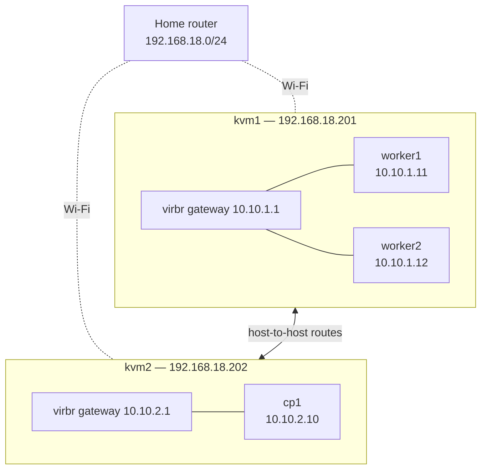

# Networking

This document is the source of truth for every address used in the homelab.
Anything that allocates an IP (Ansible inventory, libvirt network definitions,
kubeadm config, CNI config) must match what is recorded here.

## Overview

Two mini PCs run KVM/libvirt and connect to the home router over Wi-Fi only.
Wi-Fi interfaces can't be bridged, so each host gets its own **routed** libvirt
network with a dedicated VM subnet, instead of putting VMs directly on the home LAN.

## Physical hosts

| Host | IP |  CPU | RAM |
|------|----|-----|-----|
| kvm1 | 192.168.18.201 |  24 vCPU (AMD-V) | 27 GiB |
| kvm2 | 192.168.18.202 |  12 vCPU (AMD-V) | 28 GiB |

## VM networks (libvirt, routed mode)

| Host | Subnet | Gateway (host bridge) |
|------|--------|-----------------------|
| kvm1 | 10.10.1.0/24 | 10.10.1.1 |
| kvm2 | 10.10.2.0/24 | 10.10.2.1 |

## Cluster nodes

| Node | Role | Host | IP |
|------|------|------|----|
| cp | control plane | kvm2 | 10.10.2.10 |
| worker1 | worker | kvm1 | 10.10.1.11 |
| worker2 | worker | kvm1 | 10.10.1.12 |

## Kubernetes ranges

| Range | CIDR | Notes |
|-------|------|-------|
| Pods | 10.244.0.0/16 | Set explicitly in kubeadm (`podSubnet`) and the CNI config |
| Services | 10.96.0.0/12 | Set explicitly in kubeadm (`serviceSubnet`) |

Both ranges are set explicitly rather than left to defaults. Calico's default
pod CIDR (192.168.0.0/16) would overlap the home LAN.

## DNS

- **Upstream resolvers for VMs:** 1.1.1.1 and 8.8.8.8 (two providers for redundancy)
- **Node names:** written to `/etc/hosts` on every VM by Ansible, from the inventory
- **Inside the cluster:** CoreDNS serves Service names and forwards everything else
  to the node's resolvers. Pods can't resolve node hostnames by default.

See the DNS ADR for the alternatives considered.

## Overlap check

None of these ranges overlap:

| Range | Used for |
|-------|----------|
| 192.168.18.0/24 | Home LAN |
| 10.10.1.0/24 | kvm1 VMs |
| 10.10.2.0/24 | kvm2 VMs |
| 10.244.0.0/16 | Pods |
| 10.96.0.0/12 | Services (10.96.0.0 – 10.111.255.255) |

## Known follow-ups

- **Host routes:** each host needs a route to the other's VM subnet
  (kvm1: 10.10.2.0/24 via 192.168.18.202; kvm2: 10.10.1.0/24 via 192.168.18.201),
  because the router doesn't support static routes.
- **VM internet egress:** the router can't route replies to 10.10.x.x, so each host must
  masquerade VM traffic leaving for the internet. Exclude these destinations from NAT:
  10.10.0.0/16, 10.244.0.0/16, 10.96.0.0/12.
- **Wi-Fi MAC randomization:** both hosts currently use randomized Wi-Fi MACs. If
  NetworkManager generates a new one, the router reservation won't match and the host
  IP may change. Fix: set `802-11-wireless.cloned-mac-address permanent` and point the
  reservations at the hardware MACs.